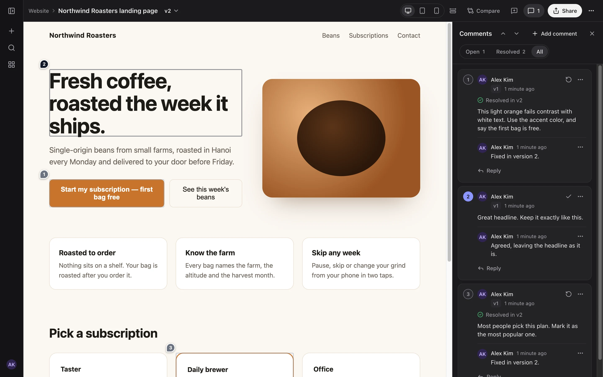
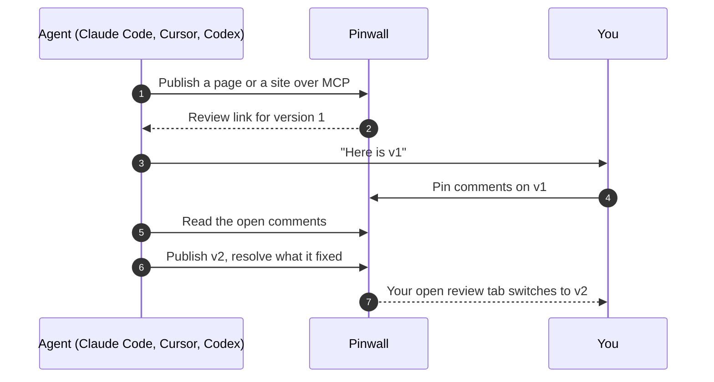
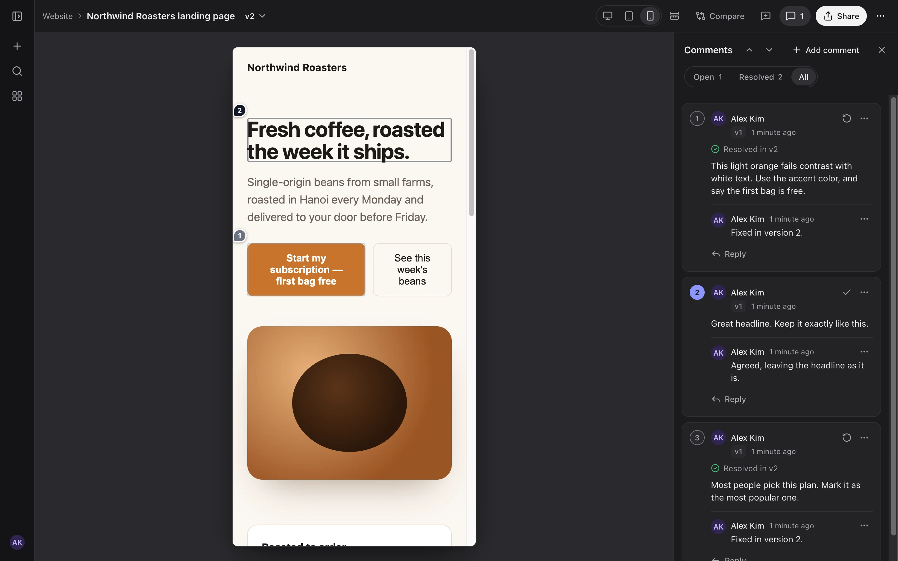
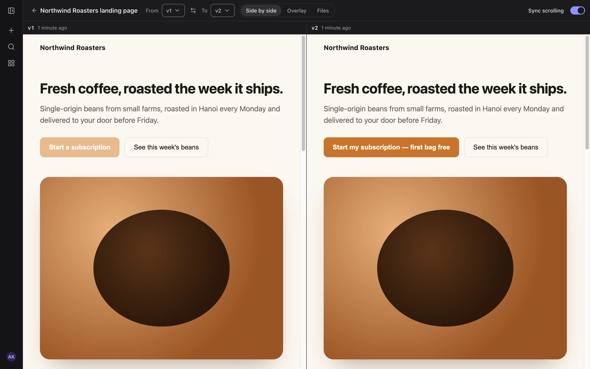
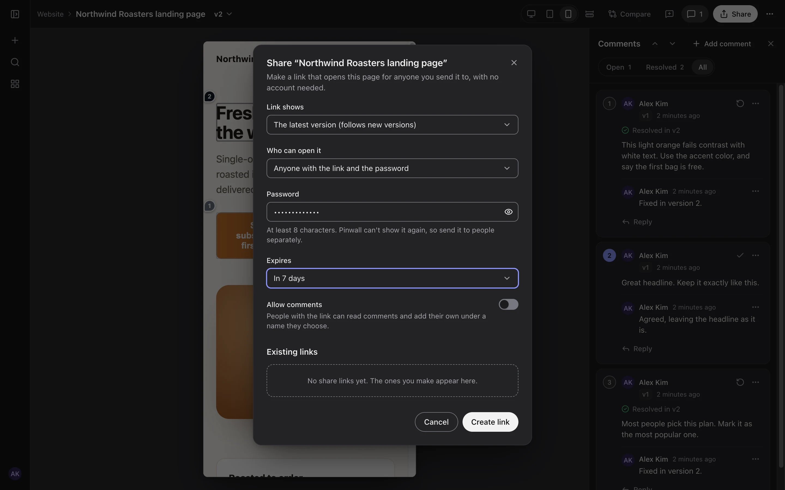
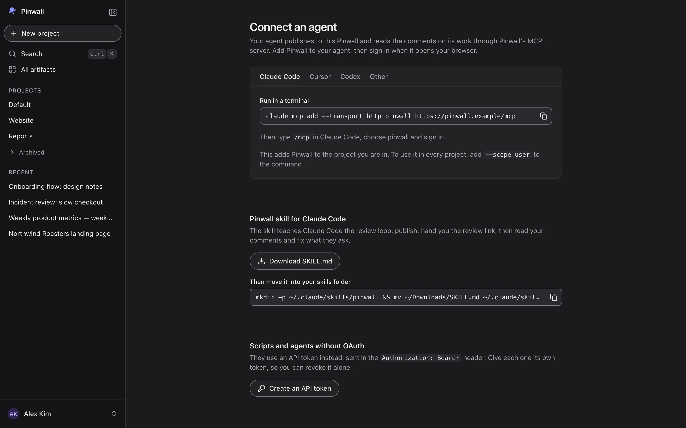

<div align="center">


# Pinwall

**The self-hosted review wall for the pages your AI agents build.**

Claude Code, Cursor, Codex and any MCP client publish HTML pages, static sites and Markdown to
Pinwall. You review every version in the browser, pin comments on the exact spot, and the agent
reads them over MCP, fixes the page and publishes the next version.

[](https://github.com/dungnguyenv/pinwall/actions/workflows/ci.yml)
[](https://github.com/dungnguyenv/pinwall/releases)
[](LICENSE)
[](https://github.com/dungnguyenv/pinwall/pkgs/container/pinwall)
[](deploy/helm/pinwall/README.md)
[](docs/connect-an-agent.md)

[Quick start](#quick-start) ·
[Connect an agent](#connect-an-agent) ·
[Features](#features) ·
[Deploy](#deploy) ·
[Docs](#documentation) ·
[FAQ](#faq)

</div>

<p align="center">
  
</p>

## Why Pinwall

Coding agents are good at making things you have to *look at*: a landing page, a dashboard, a
report, a prototype, a design doc. Reviewing them is still clumsy. The page lives in one chat or one
account, feedback goes back as screenshots and long messages, and nobody can tell which version a
remark was about.

Pinwall gives that work one home that you host yourself:

- **One place for every agent and every account.** Any MCP client can publish, and the same
  artifact is there no matter which machine, account or tool made it.
- **Feedback the agent can act on.** Comments are pinned to an element, a text selection or a point
  on the page, and the agent reads them, with the page and version they belong to, over MCP.
- **History you can trust.** Every publish is a numbered version that never changes, and each
  comment stays tied to the version it was written on.
- **Yours to run.** One container, your database, your storage, your identity provider. No
  telemetry.

## How it works



## Features

**Review**

- 📌 **Pinned comments** on an element, a text selection or any point, with threads, replies and
  resolve/reopen. Comments follow their spot when the next version moves things around.
- 📱 **Phone, tablet and desktop widths**, or any width you type, without leaving the page.
- 🔀 **Compare versions** side by side, as an overlay, or file by file, with synced scrolling.
- ⚡ **Live updates.** An open review tab switches to the new version, and new comments appear as
  they are written.
- 📝 **Markdown documents** rendered as pages, next to HTML pages and multi-page static sites.

**Agents**

- 🤖 **MCP server with built-in OAuth.** Add one URL to Claude Code, Cursor or Codex and sign in in
  the browser. No token to copy, and access renews itself.
- 📦 **Publish a file, a folder or an archive.** An agent with a shell gets a one-time upload URL
  that expires within minutes, so no long-lived secret sits in its shell. An agent without one
  publishes text files inline.
- 🗂️ **Projects with instructions** that every agent follows when it publishes there.
- 🧩 **A skill for Claude Code** that teaches the publish, review and fix loop.
- 🔌 **REST API** described by an OpenAPI document, with API tokens for scripts and CI.

**Sharing and access**

- 🔗 **Share links** for people without an account, with an optional password, an expiry date and
  guest comments, showing the latest version or one fixed version.
- 🔐 **Single sign-on** through any OpenID Connect provider, with groups mapped to admin and member,
  and access re-checked against the provider. Recipes for Zitadel, Keycloak and Google.
- 👤 **Owner account** with a passkey or a password, for a single-person install or as a way in
  while the identity provider is down.
- 🏠 **Personal spaces.** One setting gives each person a space of their own, and in the app nobody
  sees another person's work, admins included. The default, one shared library for the team, stays
  as 1.0 had it. [Spaces and members](docs/spaces.md)
- 🤝 **Project members.** An owner adds people by email as editors, who publish, or as viewers, who
  read and comment, and the project shows up under **Shared with me** for them.
- 🚦 **Guard rails for an open instance.** Admins approve who may share pages outside Pinwall, each
  person has quotas for storage, artifacts and files, and admins can look up a reported link, take
  it down or clear out an account without reading anyone's work.
  [Running an open instance](docs/open-instance.md)

**Operations**

- 🐳 **One container**, multi-arch (amd64 and arm64): SQLite and local disk to start, PostgreSQL
  and any S3-compatible storage to grow.
- ☸️ **Helm chart** for a hardened pod: non-root, read-only root filesystem, image pinned by digest.
- 🛡️ **Untrusted pages stay apart** from the app, in a sandbox on one domain or on a separate
  content domain.
- 💾 **One-command backup and restore**, also the way from SQLite to PostgreSQL and S3.
- 📈 **Prometheus metrics**, health checks and JSON logs.
- ✍️ **Signed releases** with cosign, plus SBOM and build provenance attestations.

<table>
  <tr>
    <td width="50%"><br><sub><b>Review at phone width.</b> Threads show the version they were resolved in.</sub></td>
    <td width="50%"><br><sub><b>Compare versions</b> side by side, as an overlay or file by file.</sub></td>
  </tr>
  <tr>
    <td width="50%"><br><sub><b>Share links</b> with a password, an expiry and optional guest comments.</sub></td>
    <td width="50%"><br><sub><b>Connect an agent</b> with one command, no token to paste.</sub></td>
  </tr>
</table>

## Quick start

```sh
docker run -v pinwall:/data -p 8080:8080 ghcr.io/dungnguyenv/pinwall
```

Pinwall starts with SQLite and the uploaded files in the Docker volume `pinwall`, and prints a
one-time link that creates the owner account:

```text
Pinwall setup: open http://localhost:8080/setup?token=… to create the owner account
```

Open it, choose a passkey or a password, and drag a file, a folder or an archive onto the page, or
connect an agent.

Anywhere other than a trial on your own machine, set the address people use before you create the
owner account, because links, cookies and passkeys are built from it:

```sh
docker run -v pinwall:/data -p 8080:8080 \
  -e PINWALL_PUBLIC_ORIGIN=https://pinwall.example \
  ghcr.io/dungnguyenv/pinwall
```

On Kubernetes:

```sh
helm install pinwall oci://ghcr.io/dungnguyenv/charts/pinwall --version 1.1.0 \
  --set publicOrigin=https://pinwall.example
```

The [install guide](docs/install.md) covers running in the background, a read-only container,
reverse proxies and Cloudflare Tunnel, and the chart.

## Connect an agent

In Claude Code, with your own address in place of `https://pinwall.example`:

```sh
claude mcp add --transport http pinwall https://pinwall.example/mcp
```

Add `--scope user` after `add` to have Pinwall in every project. Then type `/mcp`, pick
**pinwall** and sign in. Your browser opens on Pinwall, you approve the
agent, and Claude Code keeps and renews its own access. Then ask it to publish something:

> Build a pricing page for our coffee subscription and publish it to Pinwall.

Cursor, Codex and other MCP clients connect the same way, and clients without OAuth use an API
token: see [Connect an agent](docs/connect-an-agent.md). The **Connect an agent** page inside
Pinwall shows every snippet with your address filled in. [Writing pages for Pinwall](docs/authoring.md)
explains what a published page can and cannot do.

## Deploy

| Where | How | Guide |
| --- | --- | --- |
| One machine | `docker run`, SQLite and local disk | [Install: Docker](docs/install.md#docker) |
| Docker Compose | SQLite in a volume, or PostgreSQL with S3 storage | [deploy/compose](deploy/compose/) |
| Kubernetes | Helm chart from `oci://ghcr.io/dungnguyenv/charts/pinwall` | [Chart reference](deploy/helm/pinwall/README.md) |
| Behind a proxy or Cloudflare Tunnel | `PINWALL_PUBLIC_ORIGIN` and `PINWALL_TRUST_PROXY` | [Install: proxies](docs/install.md#behind-a-proxy-or-cloudflare-tunnel) |

### Content isolation

A page an agent writes is untrusted code, so Pinwall never runs it with the app's session. By
default (`single-domain`) pages are served under the app's own host inside a
`Content-Security-Policy: sandbox`, which needs nothing extra but is weaker than two separate sites.
With `content-domain`, every version gets a host of its own on a second domain that holds nothing
else, which is the strongest isolation and the one to choose for a team. See
[Content isolation](docs/install.md#content-isolation).

## Documentation

| Guide | What it covers |
| --- | --- |
| [Install and run](docs/install.md) | Docker, content isolation, reverse proxies and Cloudflare Tunnel, Kubernetes, metrics |
| [Sign-in](docs/sign-in.md) | The owner account, OpenID Connect, roles from groups or emails, Zitadel, Keycloak and Google, open sign-up |
| [Spaces, projects and members](docs/spaces.md) | Your space, sharing a project, sharing outside Pinwall, storage limits, deleting your content |
| [Running an open instance](docs/open-instance.md) | Personal spaces, quotas, approval, abuse reports, the moderation log, moving work between people |
| [Connect an agent](docs/connect-an-agent.md) | Claude Code, Cursor, Codex, other MCP clients, API tokens, the Claude Code skill |
| [Writing pages for Pinwall](docs/authoring.md) | Entry pages, links, what a page can keep, Markdown, limits |
| [Configuration](docs/configuration.md) | Every `PINWALL_*` setting with its default |
| [Backup and restore](docs/backup.md) | Backups, restores, moving from SQLite to PostgreSQL and S3 |
| [Helm chart](deploy/helm/pinwall/README.md) | Every chart value, secrets, upgrades |
| [Security](SECURITY.md) | The security model, verifying a release, reporting a vulnerability |

## FAQ

**Which agents work with Pinwall?**
Any client that speaks the Model Context Protocol over Streamable HTTP. Claude Code, Cursor and
Codex sign in with OAuth. Claude Desktop and other clients without a shell can publish text files
inline, and scripts use the REST API with an API token.

**Do I need a second domain?**
No. The default single-domain mode needs only the app's own address. A second domain with a
wildcard certificate gives stronger isolation between the app and the pages, and is the better
choice for a team.

**Does Pinwall send data anywhere?**
No. There is no telemetry, and Pinwall only talks to the identity provider and the storage you
configure.

**Can people outside my team see a page?**
Only through a share link that you create, optionally with a password and an expiry. Everything
else needs a signed-in account.

**Can other people on my Pinwall see my work?**
It depends on `PINWALL_VISIBILITY`. With `team`, the default, every member sees every project. With
`personal`, only you do, together with the people you add to a project and anyone you give a share
link to. See [Spaces, projects and members](docs/spaces.md#your-space).

**Can I let anyone with a Google account sign up?**
Yes, in `personal` mode, where each person gets a space of their own and sees nothing of anyone
else's. Pair it with quotas, approval for sharing outside Pinwall and a separate content domain.
[Running an open instance](docs/open-instance.md) gives the settings and the order to switch them
in, and [Spaces, projects and members](docs/spaces.md) tells the people who sign up what to expect.

**Can an admin read my private pages?**
No. In `personal` mode admins manage accounts, limits, approvals and reports, and they can delete
what an account owns, but the app does not let them open anyone's pages. The operator who runs the
server can read its database and storage, as with any self-hosted service. See
[Who can see your work](docs/spaces.md#who-can-see-your-work).

**How do I work on a project with someone?**
Open the project, choose **Members**, and add them by the email they signed in to Pinwall with, as an
editor, who can publish, or a viewer, who can read and comment. The project appears for them under
**Shared with me**. See [Project members](docs/spaces.md#project-members).

**Does upgrading from 1.0 change what people see?**
No. `PINWALL_VISIBILITY` stays `team`, so every member sees every project and every member can
share, until the operator turns on `personal` mode. Quotas and approval for sharing are off by
default as well.

**Can several Claude Code accounts or machines share one Pinwall?**
Yes. That is a main reason it exists: every machine signed in to the same Pinwall account sees the
same artifacts, and in `team` mode every member does. In `personal` mode, accounts have spaces of
their own, so share a project between them with [Members](docs/spaces.md#project-members).

**What does it run on?**
Node.js 24 with TypeScript, Hono and React, storing data in SQLite or PostgreSQL and files on local
disk or S3-compatible storage. It runs as one instance per installation.

## Contributing

Issues and pull requests are welcome. [CONTRIBUTING.md](CONTRIBUTING.md) explains how to set up the
repository, run the checks and send a change. Please report vulnerabilities privately, as
[SECURITY.md](SECURITY.md) describes.

## License

Pinwall is licensed under the [Apache License 2.0](LICENSE). The licenses of the third-party
packages that ship with it are in `THIRD_PARTY_NOTICES`, which is in the image at
`/app/THIRD_PARTY_NOTICES` and attached to every release.
